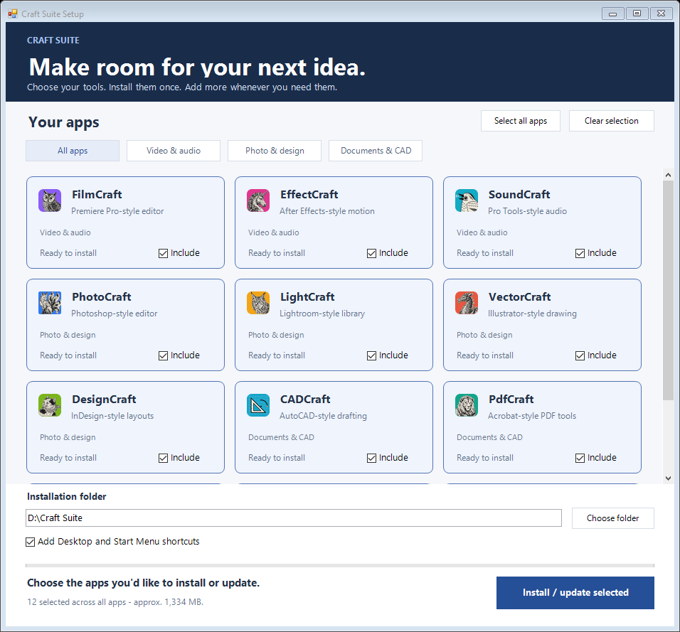

# Craft Suite — Windows installer

Twelve creative apps. One simple, offline installation.

**[Download the Windows x64 installer ZIP](https://github.com/Chynamo/craft-suite-installer/releases/download/v1.4.1-preview.1/Craft-Suite-1.4.1-Windows-x64-Setup.zip)** · [Release and checksum](https://github.com/Chynamo/craft-suite-installer/releases/tag/v1.4.1-preview.1)

## Install

1. Download **Craft-Suite-1.4.1-Windows-x64-Setup.zip** (about 708 MB).
2. Right-click the ZIP → **Extract All**. Open the extracted folder.
3. Double-click **Setup.exe**, choose a folder and tick the apps you want and select **Install / update selected**.

Keep `InstallerData` beside `Setup.exe`. All apps are included: no downloads, account or administrator access is normally needed during installation. A USB copy works too.

The app catalogue uses the actual Craft app icons, clear selection highlights and category filters. Filtering never changes your selections. The grid adapts to the window width; install controls remain visible while browsing.

## Add apps and update later

Run `Setup.exe` again and choose the **same installation folder**. Cards show **Ready to install**, **Already installed**, **Update available**, **Newer version installed**, or **Check installation folder**. Exact versions are available by hovering over an app name or status.

New and outdated apps are selected by default. Unselected apps stay installed. Updates are installed alongside the old version, then the selected app's owned shortcuts switch to the new version. Older folders and your projects are retained; this installer does not silently downgrade or uninstall anything. Run a newly downloaded bundle to compare against its newer pinned versions. No internet check or automatic background updater is included.

Each card offers **Install**, **Open**, or **Update**. The **⋯** menu lets you open the installed version, show its folder, or **Install another copy…** in a separate folder. Separate copies use local launchers without replacing your existing shortcuts. Remembered copies can be chosen through **Open another copy**; the main button follows the last-used copy. Pick an earlier installation folder once to register it. The installer does not scan the whole computer for unrelated installations.

Installation folders and last-used app copies are remembered locally. Version labels are a quick inventory check; selected files are integrity-checked during installation. Keep all payloads in the ZIP even if installing only a few apps; selecting fewer apps reduces installed storage, not the download size.

## Included apps

| App | Familiar workflow |
| --- | --- |
| [FilmCraft](https://github.com/storytold/filmcraft) | Premiere Pro |
| [EffectCraft](https://github.com/storytold/effectcraft) | After Effects |
| [SoundCraft](https://github.com/storytold/soundcraft) | Pro Tools |
| [PhotoCraft](https://github.com/storytold/photocraft) | Photoshop |
| [LightCraft](https://github.com/storytold/lightcraft) | Lightroom |
| [VectorCraft](https://github.com/storytold/vectorcraft) | Illustrator |
| [DesignCraft](https://github.com/storytold/designcraft) | InDesign |
| [CADCraft](https://github.com/storytold/cadcraft) | AutoCAD |
| [PdfCraft](https://github.com/storytold/pdfcraft) | Acrobat |
| [WordCraft](https://github.com/storytold/wordcraft) | Word |
| [GridCraft](https://github.com/storytold/gridcraft) | Excel |
| [DeckCraft](https://github.com/storytold/deckcraft) | PowerPoint |

For video, motion graphics, audio, photography, illustration, layouts, CAD and documents. Versions and original release links are in [bundle.lock.json](bundle.lock.json). ArtCraft Studio is excluded.

## Requirements and preview status

Windows 10/11 **x64**, built-in Windows PowerShell 5.1 and .NET Framework. Allow roughly **3 GiB free** when keeping the downloaded ZIP, extracted installer and installed apps on one drive. GPU requirements vary by app.

This is an **unofficial community preview**, maintained by Chynamo, containing unmodified releases from [the ArtCraft team](https://github.com/storytold). It is not endorsed by the original publisher. The launcher is unsigned, so Windows may show a security/reputation warning. Follow your device's security policy.

Selective installation, add/repeat safety, bundled-version comparisons, simulated upgrade/downgrade preservation, damaged-payload rejection and the graphical launcher were tested on the maintainer's Windows PC. A clean second PC, high-DPI screens and every app feature remain unverified. Report problems through [Issues](https://github.com/Chynamo/craft-suite-installer/issues); remove personal information from logs before sharing.

The installer preserves intact existing versions and refuses to overwrite changed original files. Keep your projects outside `Apps`. Personal projects, credentials and AI/MCP configurations are not included. It does not configure an AI service for you.

## Build from source

End users should download the installer ZIP above, **not GitHub's Source code ZIP**.

Maintainers need Windows x64, Python 3.11+ and the built-in .NET Framework C# compiler. Run `python build.py`. This downloads the pinned upstream ZIPs, checks their SHA-256 hashes, compiles the graphical launcher and writes the ZIP/checksum under `dist/`.

To reuse an existing official community bundle without redownloading: `python build.py --from-bundle "path/to/Craft-Suite-1.4.1-Windows-x64-Setup.zip"`. Use `--validate-only` to check inputs and compile the launcher without assembling the large output. No installation is performed by the builder. Rebuilt archives are not guaranteed byte-identical to the published ZIP.

Software names describe the workflows referenced by the original team; these independent apps are not the Adobe, Microsoft, Autodesk or Avid products and do not claim full feature parity.

## Licences

The installer wrapper is [MIT licensed](LICENSE). Each app, font and asset retains its upstream licence, copyright and notices in [third_party/Notices](third_party/Notices) and in the downloadable bundle. This repository does not relicense the apps or claim ownership of ArtCraft trademarks.
